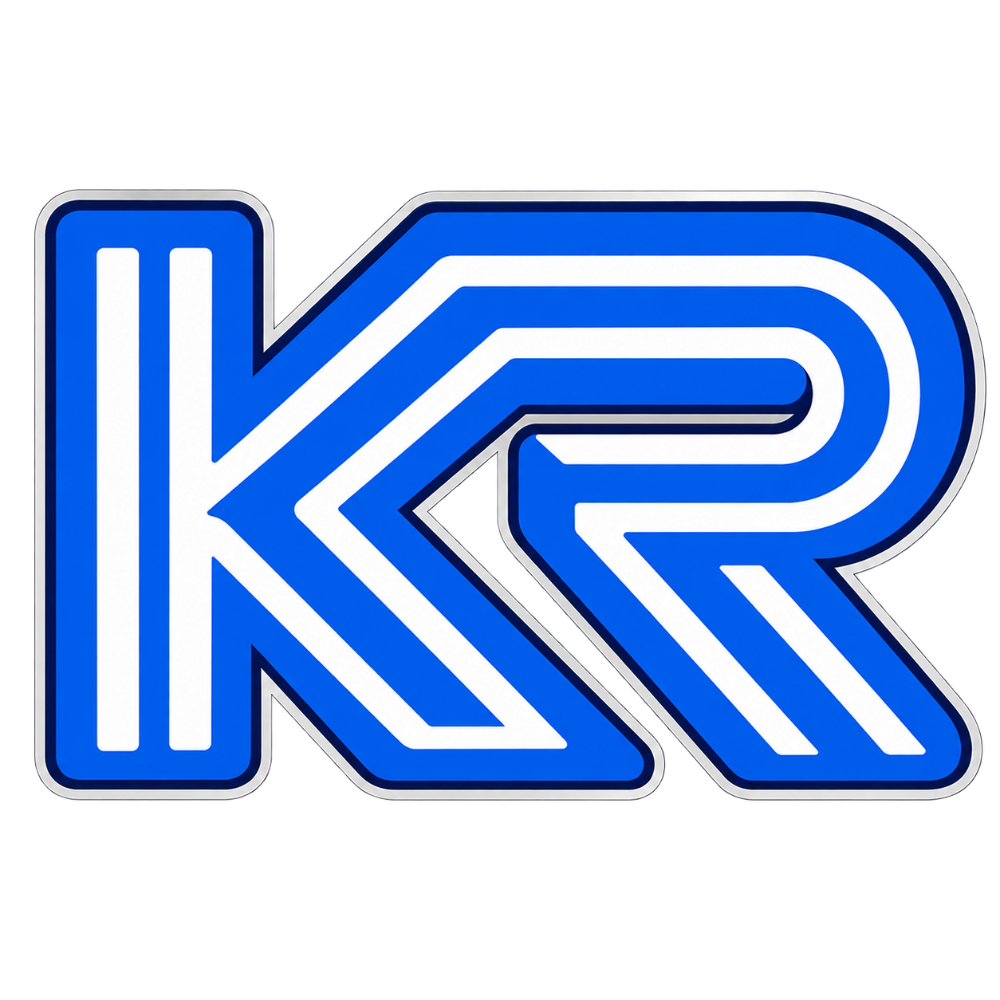

# Kega Refusion

A Sega emulator for **Windows and Linux**, built with C++17 and Qt 6. Inspired by Kega Fusion, with a compact interface, modern input support, rewind, direct netplay and video recording.

Emulation is based on a modified **Genesis Plus GX** core, with integrated 32X support. This is an independent project, not an official Kega Fusion update.

[Build from source](docs/building.md) · [Documentation](docs/README.md) · [Translations](languages/README.md) · [Third-party credits](THIRD_PARTY.md)

## Supported systems

| System | Support |
|---|---|
| Mega Drive / Genesis | Cartridge games, including supported unlicensed mappers and J-Cart |
| Master System, Game Gear, SG-1000 | Cartridge games; automatic and manual region selection |
| Sega CD / Mega-CD | CUE/BIN, ISO, CHD, M3U playlists and supported MP3 audio tracks |
| 32X and Sega CD + 32X | Integrated, experimental support; compatibility is still being improved |
| Paprium | Experimental cartridge support, external MP3 soundtrack and CPU MATE integration |

Supply your own games and Sega CD BIOS files. The 32X uses each recognized original G/M/S BIOS when available and a built-in fallback for each missing piece. CD32X still requires the Sega CD BIOS for the selected region.

## Features

- **Play comfortably:** keyboard and gamepads together, illustrated bindings, 3/6-button pads, multitaps, light guns, Mega Drive Mouse and Master System Paddle.
- **Stay in control:** pause, single-frame steps in both directions, adjustable fast-forward, memory-limited rewind, ten quick-save slots and save/load to a chosen file. Battery saves and quick-save slots keep one backup.
- **Tune the picture and sound:** console or square-pixel aspect, integer scaling, Blargg filters, built-in dither blending, RetroArch GLSL presets with LUTs, multipass and temporal effects, output-device selection and live audio latency profiles. Normal latency is the default.
- **Play together:** invitation-based direct netplay using GGPO rollback, Windows/Linux interoperability, spectators, shared controller roles and optional game-file transfer. Link Cable mode supports compatible Mega Drive cartridges.
- **Record and export:** a game time display in the upper-right corner showing elapsed time or frames since reset, replayable input recordings, screenshots, live video capture and input-recording export. Video uses native-resolution lossless PNG frames with AAC audio in MOV, without OSD.
- **Explore games:** Game Genie / Action Replay, CHT import/export, manual cheat search and graphics/audio-channel debugging windows.
- **Achievements:** RetroAchievements integration, a sortable achievement list and optional notifications. Sign-in is required to fetch achievement sets; netplay supports Softcore.
- **Keep it portable:** settings and saves live beside the application by default. In **Settings → Folders**, relative paths move with the data folder. Custom absolute paths are specific to Windows or Linux. English and Russian are included, with external JSON translations and English fallback.

## Getting started

Extract the entire package into a writable folder. On Windows, run `KegaRefusion.exe`; on Linux, run `./run.sh` from the extracted folder. Keep the bundled libraries, `cores` and `plugins` alongside the executable.

Open a game with **Ctrl+O**, drag it onto the window, or click the central **+** area. ZIP/7z cartridge archives can be opened directly. Configure BIOS files, controllers, audio and other preferences in **Settings → Emulator settings**.

For Kaiser Wave cartridges such as *Death & Lead* and *The Secret of the Four Winds*, keep the numbered MP3 files (`01.mp3`, `02.mp3`, …) beside the ROM or its archive. Four Winds offers **Enhanced Music** and **FM Music** after language selection. Keep the complete soundtrack for both options. Netplay includes those tracks when transferring the cartridge.

Settings and saves live in `data/`. Keep this folder when updating; use `--data /path/to/folder` to choose another location. Save names follow the game filename, so identically named games share their save location.

In **Emulator settings → Controls**, double-click a keyboard or gamepad cell to add a binding. Each cell keeps the two most recent distinct bindings. Middle-click to clear both. **Assign all** replaces both bindings with one for each action you assign. Skipping an action keeps its bindings. A conflicting input moves to the new action. Keyboard commands accept modifier combinations, and menus show the first shortcut.

| Default shortcut | Action |
|---|---|
| Arrow keys · Z/X/C · A/S/D · Enter | Player 1 directions · A/B/C · X/Y/Z · Start |
| P | Pause / resume |
| Ctrl+R · Ctrl+Shift+R | Reset · power restart |
| `,` · `.` | Previous frame · next frame while paused (hold to repeat) |
| [ · ] | Decrease / increase game speed by 5 percentage points |
| Tab · R | Hold fast-forward · hold rewind (doubles every 2 seconds up to 16× by default) |
| 0–9 · F5/F8 | Select save slot · save/load slot |
| Shift+F5 · Shift+F8 | Save to file · load from file |
| Alt+Enter · Esc | Fullscreen · show/hide fullscreen menu or release captured mouse |
| + / − · F12 | Master volume · screenshot |

Bindings can be changed in **Controls**. Keyboard input follows physical keys, including with a Russian layout.

## Netplay

Create a session, copy its invitation and send it to another player. New participants join as spectators; the host assigns roles in the lobby. Use the **LAN invitation** for computers on the same local network.

The default port is **33445 TCP and UDP**. Internet play requires a reachable host; there is no relay or matchmaking service. Use the same emulator build on all participants. See the [netplay guide](docs/netplay.md) for connection, role and disconnect behavior.

## Requirements and building

- **Windows:** x86-64, Windows 10 1809+ or Windows 11 for the current Qt 6.10 package.
- **Linux:** x86-64, X11 or Wayland. The portable release requires glibc 2.36 or later (Debian 12 baseline) and includes Qt.
- **Graphics:** desktop OpenGL 2.1 with a working driver. Emulation runs on the CPU; external shader requirements can vary.

Linux builds from source with Qt 6.4 or later. Windows is cross-compiled with MinGW-w64 and Qt 6.10.2. Both packages use a minimal FFmpeg for PNG/AAC recording in MOV.

See [Building and packaging](docs/building.md) for dependencies, commands, incremental builds and focused checks. Build outputs and downloaded dependencies stay under the ignored `build/` directory.

## Project notes

32X, CD32X and Paprium remain experimental. Input-recording version mismatches produce a warning rather than blocking playback, but identical replay across every future core change cannot be guaranteed. Kega Fusion save states are not imported. RetroAchievements Hardcore availability depends on service approval; the client does not impersonate another emulator.

[Technical notes and compatibility reports](docs/README.md) document implementation details and the scope of completed checks. Some older reports are in Russian.

Created by **vova791 — Vladimir Salata**, with **Codex ChatGPT**.

Original project code is **GPL-3.0-or-later with a core linking exception**. See [Licensing](LICENSING.md), the [GPL text](LICENSE), and the [exception](LICENSE-EXCEPTION). Third-party code keeps its own terms, including the integrated core’s non-commercial restrictions; [THIRD_PARTY.md](THIRD_PARTY.md) lists upstream authors and licenses.
